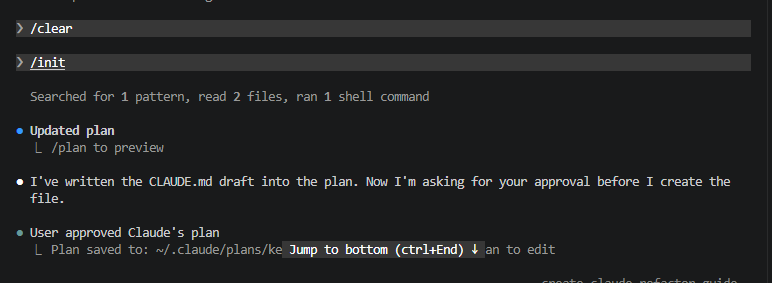

# Bitácora de refactorización

**Nombre:** Martin Juarez
**Matrícula:** [COMPLETAR]
**Fecha:** 2026-10-06

## Inicio del proyecto

Sesión de Claude Code al ejecutar `/init`: generó el borrador de `CLAUDE.md` como plan y pidió aprobación antes de crear el archivo.

**Evidencia de inicio** ([`docs/evidencias/00_inicio.txt`](docs/evidencias/00_inicio.txt), commit `10e3398`), tomada sobre el código original (commit `e42f747`) antes de cualquier refactorización:

- `pytest`: **20 passed** (las 20 pruebas originales del reto).
- `ruff check src`: **20 errores**, 7 de ellos corregibles con `--fix`. Los dos más serios: `menu` demasiado compleja (17 > 10) y `registrar_venta` demasiado compleja (12 > 10).

## Diagnóstico

**Commit:** `c60bcf9` · **Modo:** plan (solo lectura; Claude Code no editó nada hasta que aprobé el plan).

**Prompt usado:**

> No edites nada todavía, solo quiero entender el código.
>
> Revisa src/ y dime qué problemas de calidad tiene (code smells). Puedes empezar por lo que marca ruff check src, pero dime también lo que ruff no detecta.
>
> Dame:
> 1. Una tabla: archivo y línea | problema | qué tan grave es | qué tan fácil es romper los tests si lo arreglo.
> 2. Un orden sugerido para arreglarlos, de lo más seguro a lo más riesgoso, un cambio por commit.
> 3. Cosas raras del programa que parecen error pero que NO debo cambiar porque los tests o el comportamiento dependen de ellas.
>
> Cuando te lo apruebe, crea BITACORA.md a partir de BITACORA_TEMPLATE.md con estas columnas:
> | # | Prompt usado | Modo | Cambio realizado | Justificación | Tests OK | Ruff (antes → después) |
> Pon este diagnóstico al inicio en una sección "Diagnóstico" junto con este prompt. Haz commit.

**Línea base:** `pytest` → 20 passed; `ruff check src` → 20 errores (7 corregibles con `--fix`). Evidencia en `docs/evidencias/00_inicio.txt`. `main.py` no tiene ninguna prueba: los cambios ahí se validan corriendo la app con entradas guionadas y comparando la salida antes/después.

### 1. Problemas encontrados

Gravedad: Alta = dificulta entender/cambiar el código o esconde bugs; Media = duplicación o confusión; Baja = cosmético. Riesgo = qué tan fácil es romper tests o comportamiento al arreglarlo.

#### Detectados por ruff (20)

| Archivo:línea | Problema | Gravedad | Riesgo al arreglar |
|---|---|---|---|
| `main.py:21` | C901 `menu` demasiado compleja (17 > 10): un `if/elif` gigante que pide datos, llama a la lógica e imprime | Alta | Medio — **sin tests**; hay que comparar la salida a mano |
| `gestor.py:86` | C901 `registrar_venta` demasiado compleja (12 > 10): valida, calcula, descuenta stock, arma folio, ticket y registro | Alta | Medio-alto — orden de mensajes de error, ticket, `descuento` entero |
| `gestor.py:126-128` | SIM102 ×3: cuatro `if` anidados para el descuento VIP | Media | Medio — la condición `> 200` es sobre `subtotal - descuento` |
| `gestor.py:120` | SIM108 `if/else` anidado para el descuento por volumen | Baja | Bajo |
| `almacen.py:16`, `:30`; `reportes.py:86` | SIM115 archivos abiertos sin `with` (si falla `json.dump`/`json.load` el archivo queda abierto) | Media | Bajo |
| `almacen.py:48` | N802 `hayArchivo` no es snake_case | Baja | Bajo — lo usa `main.py`, hay que renombrar ahí también |
| `almacen.py:50` | SIM103 `if ...: return True else: return False` | Baja | Nulo |
| `reportes.py:83` | N802 `reporteViejoCSV` (además es código muerto) | Baja | Nulo |
| `gestor.py:15` | N816 `contadorVentas` mixedCase | Baja | Bajo-medio — se reasigna; usarlo como `gestor.<nombre>` en `almacen.py` |
| `reportes.py:4` | F401 `import os` sin usar | Baja | Nulo |
| `main.py:4` | I001 imports desordenados | Baja | Nulo |
| `almacen.py:30` | UP015 `"r"` innecesario en `open` | Baja | Nulo |
| 4 archivos, línea 1 | UP009 `# -*- coding: utf-8 -*-` innecesario | Baja | Nulo |

#### Que ruff NO detecta

| Archivo:línea | Problema | Gravedad | Riesgo al arreglar |
|---|---|---|---|
| `gestor.py:114-121` y `173-179` | **Lógica duplicada**: el descuento por volumen y el IVA están copiados en `registrar_venta` y `cotizar`; si cambia una regla hay que acordarse de las dos | Alta | Medio — `cotizar` no debe aplicar VIP |
| `gestor.py:117-132`, `173-181`; `reportes.py:18`, `:31` | **Números mágicos**: 1000, 500, 0.10, 0.05, 200, 0.02, 0.16, 5, `"VIP"` | Media | Bajo si se respetan `>=`, `>` y `<` |
| `gestor.py:148-159` | Ticket armado con `t = t + ...` dentro de `registrar_venta` (mezcla formato con lógica de negocio) | Media | Medio — el texto debe quedar idéntico |
| `gestor.py:95-112` | Validación con 4 niveles de `if/else` en vez de cláusulas de guarda | Media | Medio — el orden decide el mensaje |
| `gestor.py:185-197`, `:17`; `reportes.py:83-92` | **Código muerto**: `calcular_descuento_viejo`, `exportar_txt` comentado, `reporteViejoCSV`, `MODO_DEBUG` | Media | Nulo (nadie los llama) |
| todos | **Nombres crípticos**: `x`, `aux`, `temp`, `temp2`, `t`, `s`, `d`, `p`, `c`, `n`, `op`, `hacer_cosa` | Media | Bajo |
| `reportes.py:59-66` | Ordenamiento de burbuja hecho a mano (el propio comentario dice "usar sorted") | Media | Bajo — conservar orden en empates y que sean tuplas |
| `reportes.py:18` y `:31` | Regla de stock bajo (`< 5`) repetida en dos funciones | Baja | Bajo |
| `reportes.py:69-79` | `resumen_ventas` vuelve a sumar los totales en vez de usar `total_vendido` | Baja | Bajo |
| `gestor.py:13-17`, `almacen.py`, `reportes.py` | **Estado global** compartido entre módulos; `almacen` escribe directo en `gestor` | Alta | **Alto** — los tests usan `gestor.INVENTARIO`/`VENTAS`; recomiendo no eliminarlo, solo encapsular el acceso |
| `gestor.py` (todas) | Errores comunicados por la variable global `ultimo_error` en vez de excepciones | Media | **Alto** — `main.py` y el contrato `False`/`None` dependen de ella; no cambiar |
| `main.py:21-82` | Entrada/salida mezclada con la lógica (formato de `mas_vendidos` y de stock bajo vive en el menú) | Media | Medio — sin tests |
| `almacen.py:33` | `except Exception` demasiado amplio | Baja | Bajo — si se acota, usar `ValueError` (cubre JSON y UTF-8 inválidos) |
| `almacen.py:39-44` | Copia elemento por elemento en vez de `.update()` / `.extend()` | Baja | Bajo — debe seguir mutando en sitio |
| todos | Sin type hints; algunas funciones con comentario en vez de docstring (`agregarProducto`, `buscarProducto`, `hayArchivo`, `hacer_cosa`, `pedir_numero`) | Baja | Nulo |

---

### 2. Orden sugerido (de lo más seguro a lo más riesgoso, un commit cada uno)

| # | Refactorización | Archivos | Ruff esperado | Riesgo |
|---|---|---|---|---|
| 1 | `ruff check src --fix` (encoding, `"r"`, imports, `os` sin usar). *Cosmético: no cuenta entre las 5 significativas* | todos | 20 → 13 | Nulo |
| 2 | Eliminar código muerto (`calcular_descuento_viejo`, `exportar_txt`, `reporteViejoCSV`, `MODO_DEBUG`) | gestor, reportes | 13 → 11 | Nulo |
| 3 | Persistencia: `with open`, `hayArchivo` → `hay_archivo` (y en `main.py`), `return os.path.exists(...)`, nombres claros | almacen, main | 11 → 7 | Bajo |
| 4 | `contadorVentas` → `contador_ventas` (la llave `"contador"` del JSON no cambia) | gestor, almacen | 7 → 6 | Bajo |
| 5 | Reportes: `hacer_cosa` → `formatear_dinero`, `sorted(..., reverse=True)` en vez de burbuja, constante `STOCK_MINIMO`, nombres claros, reusar `total_vendido` | reportes | 6 → 6 | Bajo |
| 6 | Constantes de negocio + función única de descuento por volumen e IVA usada por `registrar_venta` y `cotizar` | gestor | 6 → 5 | Medio |
| 7 | Dividir `registrar_venta`: guardas para validar, `calcular_extra_vip`, `armar_ticket` | gestor | 5 → 1 | Medio-alto |
| 8 | Dividir `menu`: una función por opción + diccionario de opciones (validar con salida guionada antes/después) | main | 1 → 0 | Medio |
| 9 | Type hints y docstrings en español en todo `src/` | todos | 0 → 0 | Nulo |

No recomendado: quitar el estado global o cambiar `ultimo_error` por excepciones (rompería tests y el contrato con `main.py`).

---

### 3. Cosas raras que NO hay que cambiar

1. `cotizar("")` responde `"producto no existe"` (no `"codigo vacio"`) y `cotizar` no revisa stock.
2. `cotizar` no aplica el descuento VIP; `registrar_venta` sí.
3. El extra VIP es 2% **del subtotal** (no de lo ya descontado) y solo si `subtotal - descuento > 200` (estricto).
4. Sin descuento, `descuento` vale `0` entero, no `0.0`; la línea "Descuento" del ticket solo sale si es > 0.
5. El dinero se muestra como `$10.0`, `$32.5` (`str(round(v, 2))`), nunca `$10.00`. En el ticket, un subtotal entero sale `$20`.
6. `total` usa el IVA **sin redondear**; `impuesto` se guarda redondeado. Puede que `subtotal - descuento + impuesto` difiera por un centavo de `total`: es así a propósito.
7. Stock bajo es `< 5`: un producto con 5 unidades **no** es stock bajo. Stock inicial 0 sí es válido; precio 0 no.
8. `mas_vendidos` regresa **tuplas** `(codigo, unidades)`, en empates queda primero el que se vendió primero, y el menú imprime el código, no el nombre.
9. `reporte_inventario` y `resumen_ventas` imprimen **y** regresan el texto.
10. `cd src && python main.py` carga `src/datos_ejemplo.json`, no el de la raíz: arranca vacío.
11. En el menú, `int(pedir_numero(...))` trunca (`2.7` → `2`), y escribir `nan` o `inf` truena el programa. Es un bug real, pero arreglarlo cambia el comportamiento: va aparte, no dentro de una refactorización.
12. `cargar_datos`: si falta `"contador"` usa 0, pero si falta `"inventario"` lanza `KeyError` (no se atrapa). `guardar_datos` siempre regresa `True`.
13. `cliente=None` en `registrar_venta` funciona y se guarda como `None`.

## Refactorizaciones

Registra aquí **cada refactorización** que realices con Claude Code. Copia el
prompt tal cual lo escribiste (o un resumen fiel si fue una conversación larga),
describe el cambio que se aplicó al código y justifica por qué mejora la calidad.
Después de cada cambio ejecuta `pytest` y `ruff check src` y anota el resultado.

**Modo** = modo de Claude Code con el que se hizo el cambio: plan, normal (aprobando cada edición) o auto-aceptar ediciones. "plan → normal" = se planeó en modo plan y se ejecutó al aprobar; "propuesta → OK" = la propuesta se dio en la conversación normal y se esperó mi OK antes de editar. **Commit** = hash corto de `git log`. **Captura** = imagen de la sesión de Claude Code con el prompt de esa refactorización (carpeta `imgs/`).

| # | Prompt usado | Modo | Cambio realizado | Justificación | Tests OK | Ruff (antes → después) | Commit | Captura |
|---|---|---|---|---|---|---|---|---|
| 0 | Antes de empezar a refactorizar quiero más seguridad de no romper nada. Crea un archivo NUEVO tests/test_casos_borde.py (no toques los otros tests) que pruebe cómo funciona el código HOY, aunque algo parezca raro: - el texto completo del ticket con descuento y sin descuento - los mensajes de error de ultimo_error - el VIP justo en 200 (no aplica), arriba de 200 (sí aplica) y con "vip1" en minúsculas (no aplica) - que cotizar no aplica VIP - el formato "$10.0" en los reportes y "$0" cuando no hay ventas - mas_vendidos con empate - stock en 5 (no es bajo) y en 4 (sí es bajo) Todos deben pasar con el código actual; si uno falla, el que está mal es el test. Corre pytest, guarda la salida en docs/evidencias/, anótalo en la bitácora como fila #0 y haz commit. | normal | **Red de seguridad, no es refactorización.** Nuevo `tests/test_casos_borde.py` con 21 pruebas de caracterización que fijan el texto exacto del ticket y de los reportes, los 10 mensajes de error y su orden, los límites del VIP (incluye VIP + volumen), `cotizar` sin VIP ni stock, `descuento` 0 entero, empates en `mas_vendidos` y stock bajo `< 5`. No se tocaron `src/` ni los tests originales. | La suite original solo revisa totales; no detectaría un cambio en el ticket, en los mensajes de error, en `$10.0` → `$10.00` o en el orden de empates, que son justo los riesgos de las refactorizaciones 6–8. Evidencia: `docs/evidencias/00_casos_borde.txt`. | ✅ 41/41 (20 originales + 21 nuevas; las nuevas pasaron a la primera) | 20 → 20 | `d260918` | [r0](imgs/r0.png) |
| 1 | Refactorización 1: quiero quitar código muerto. - En gestor.py: calcular_descuento_viejo, el bloque comentado de exportar_txt y la variable MODO_DEBUG. - En reportes.py: reporteViejoCSV y el import os que no se usa. - En todos los archivos: la línea "# -*- coding: utf-8 -*-". Antes de borrar, revisa con grep que nadie los use, ni en src/ ni en tests/.  Al terminar: 1. Corre pytest y ruff check src --statistics y guarda la salida en docs/evidencias/01_codigo_muerto.txt. 2. Si algo falla, regresa los cambios y dime por qué. 3. Agrega la fila 1 a BITACORA.md con este prompt, qué cambió, por qué mejora y el resultado de los tests y de ruff. 4. Haz commit. | normal | Se verificó con `grep` en `src/` y `tests/` que cada elemento solo aparecía en su propia definición. Se eliminaron `calcular_descuento_viejo`, el bloque comentado `exportar_txt` y `MODO_DEBUG` (`gestor.py`); `reporteViejoCSV` e `import os` (`reportes.py`); y la línea de *encoding* en los 4 archivos de `src/` (en `tests/` se dejó porque no se modifican). −35 líneas. | El código que nadie llama confunde ("¿esto se usa?"), hay que mantenerlo y aparece en búsquedas. `reporteViejoCSV` además abría el archivo sin `with` y no seguía snake_case. En Python 3 el *encoding* UTF-8 ya es el predeterminado, así que esa línea sobra. Si algún día se necesita algo de esto, está en el historial de git. Como `main.py` no tiene pruebas, se probó también la app con entradas guionadas (8 opciones, salida correcta). | ✅ 41/41 | 20 → 13 (−4 UP009, −1 F401, −1 N802, −1 SIM115) | `4eb5e32` | [r1](imgs/r1.png) |
| 2 | Refactorización 2: en gestor.py y reportes.py hay números sueltos que no se entiende qué significan: 1000, 500, 0.10, 0.05 (descuentos por volumen), "VIP", 3, 200, 0.02 (cliente VIP), 0.16 (IVA) y 5 (stock mínimo).  Conviértelos en constantes con nombre en MAYÚSCULAS al inicio de gestor.py, con un comentario corto. En reportes.py usa gestor.STOCK_MINIMO en vez de repetirla. Úsalas en registrar_venta y también en cotizar.  Importante: los resultados tienen que salir exactamente iguales. No cambies el orden de las operaciones ni dónde se redondea, y el descuento inicial se queda como 0 (no 0.0).  Al terminar: pytest + ruff → docs/evidencias/02_constantes.txt, fila 2 en la bitácora con este prompt, y commit. | normal | Nueva sección "Reglas de negocio" al inicio de `gestor.py` con 9 constantes comentadas: `MONTO_DESCUENTO_ALTO`/`TASA_DESCUENTO_ALTO`, `MONTO_DESCUENTO_MEDIO`/`TASA_DESCUENTO_MEDIO`, `PREFIJO_VIP`, `MONTO_MINIMO_VIP`, `TASA_EXTRA_VIP`, `TASA_IVA` y `STOCK_MINIMO`. Se usan en `registrar_venta` y `cotizar`; `reportes.py` usa `gestor.STOCK_MINIMO` en sus dos comparaciones. Para el `3` no se creó otra constante: se usa `len(PREFIJO_VIP)`, que es lo que significa. Solo se sustituyeron números por nombres: mismas operaciones, mismo orden, mismos redondeos y `desc = 0` entero. | Cada número ahora tiene nombre y comentario, y vive en un solo lugar: cambiar el IVA o el stock mínimo es editar una línea (antes el 5 estaba en dos funciones y el 0.16 en dos). Derivar el 3 de `PREFIJO_VIP` evita que se desincronicen si cambia el prefijo. Además de las pruebas, se comparó la versión anterior contra la nueva en 20 000 ventas y cotizaciones al azar (con precios enteros y decimales y clientes `VIP`, `vip1`, `None`, etc.): resultados y tipos idénticos. | ✅ 41/41 | 13 → 13 (ninguna regla de ruff cubre números mágicos; el SIM108 y los SIM102 se quedan para cuando se aplanen los `if`) | `84175ef` | [r2](imgs/r2.png) |
| 3 | Refactorización 3: registrar_venta y cotizar en gestor.py repiten el mismo cálculo (subtotal, descuento por volumen, base e IVA). Quiero sacarlo a funciones pequeñas que usen las dos.  Antes de editar, explícame: - en qué se diferencian las dos funciones (por ejemplo cotizar no aplica VIP ni revisa stock), - qué funciones nuevas propones, con nombre que empiece con \_ y una línea de qué hacen, - por qué el resultado sigue siendo exactamente el mismo, sobre todo en 500 y 1000. Espera a que te diga que sí.  No cambies los nombres de las funciones públicas, lo que regresan, los mensajes de error ni el orden en que se validan las cosas.  Al terminar: pytest + ruff → docs/evidencias/03_extraer_calculos.txt, fila 3 en la bitácora (modo: plan → normal) y commit. | plan → normal | En plan, Claude Code explicó las diferencias (validación y su orden, VIP solo en ventas, efectos, retorno y redondeos) y propuso 3 funciones privadas en `gestor.py`: `_calcular_subtotal(precio, cantidad)`, `_descuento_por_volumen(subtotal)` (guardas con `return`, mismo orden `>= 1000` y luego `>= 500`, `return 0` entero) y `_calcular_iva(base)`. Ya aprobado, `registrar_venta` y `cotizar` las usan; validaciones, bloque VIP, ticket y redondeos sin tocar. | El cálculo vive en un solo lugar: cambiar una regla de descuento o el IVA ya no exige editar dos funciones que podían desincronizarse. Las comparaciones y operaciones de punto flotante son las mismas en el mismo orden, así que 1000 → 10 %, 999.99 → 5 %, 500 → 5 %, 499.99 → 0. Comprobado comparando la versión anterior contra la nueva en 32 casos límite (499.99/500/500.01, 999.99/1000/1000.01, VIP en 200/200.01, con precios `int` y `float`) y 20 000 al azar: venta completa, tipos (`descuento` 0 sigue `int`) y `cotizar` idénticos. | ✅ 41/41 | 13 → 11 (−SIM108; −C901 de `registrar_venta`, cuya complejidad bajó de 12 a 10) | `4b26bb2` | [r3](imgs/r3.png) |
| 4 | Refactorización 4: hay if muy anidados en gestor.py y almacen.py. Quiero que las validaciones salgan rápido en vez de meterse cada vez más adentro. Ejemplo de lo que quiero:  Antes: `    if codigo is not None and codigo != "":` `        if codigo in INVENTARIO:` `            ...` `        else:` `            ultimo_error = "producto no existe"; return None` `    else:` `        ultimo_error = "codigo vacio"; return None`  Después: `    if codigo is None or codigo == "":` `        ultimo_error = "codigo vacio"` `        return None` `    if codigo not in INVENTARIO:` `        ultimo_error = "producto no existe"` `        return None` `    ...`  Aplícalo a: - las validaciones de registrar_venta (mismo orden y mismos mensajes), - la validación de cliente VIP (son 4 if anidados, déjalo en una sola condición clara que no truene con None o ""), - el descuento por volumen (quitar el else anidado), - hayArchivo en almacen.py (que regrese os.path.exists directo). No uses "if not codigo" porque cambiaría qué se considera vacío.  Al terminar: pytest + ruff → docs/evidencias/04_condicionales.txt, explícame en una tabla por qué cada condición nueva hace lo mismo que la anterior, fila 4 en la bitácora y commit. | normal | `registrar_venta`: la pirámide de 4 niveles `if/else` pasa a 4 cláusulas de guarda en el mismo orden y con los mismos mensajes; se quitó `temp2 = None`. VIP: los 4 `if` anidados pasan a `es_vip = cliente is not None and cliente.startswith(PREFIJO_VIP)` y un solo `if es_vip and aux - desc > MONTO_MINIMO_VIP`. `hayArchivo`: `return os.path.exists(ruta)`. El descuento por volumen **ya no tenía** `else` anidado (se arregló en R3 con `_descuento_por_volumen`), así que no se tocó. Ver "Detalle de la refactorización 4" abajo. | Se lee de arriba abajo: cada guarda descarta un caso y el camino feliz queda sin sangría. Para las cantidades se negó la condición original (`not cantidad > 0`, `not stock >= cantidad`) en vez de invertir el operador (`<= 0`, `<`): con `nan` la versión "obvia" **registra una venta con cantidad NaN**, comprobado en una copia aparte. Comparación contra la versión anterior: 1 400 combinaciones de entradas raras (código `None`/`""`/inexistente/minúsculas, cantidad `None`/0/negativa/`nan`/`inf`/decimal, stock 0 y 5, 10 clientes), con el mismo `ultimo_error`, inventario, ventas y tipo de excepción; más 20 000 ventas al azar y `hayArchivo` con archivo/carpeta/inexistente/`""`. Todo idéntico. | ✅ 41/41 | 11 → 7 (−3 SIM102, −1 SIM103) | `b17a7ca` | [r4](imgs/r4.png) |
| 5 | Refactorización 5: registrar_venta todavía hace muchas cosas: valida, calcula, baja el stock, saca el folio, arma el registro y el ticket. ruff dice que es muy compleja (C901).  Propón cómo dividirla antes de editar. Mi idea: - \_generar_ticket: el texto del ticket debe quedar idéntico, letra por letra. - \_construir_registro_venta: mismas claves y en el mismo orden. - \_siguiente_folio: para el contador de ventas. - registrar_venta queda corta, solo llamando a las demás en el mismo orden de antes.  Al terminar: pytest + ruff → docs/evidencias/05_dividir_registrar_venta.txt (registrar_venta ya no debe salir en C901), fila 5 en la bitácora y commit.  *(Respuesta a la propuesta: "si", sin `_validar_venta`.)* | plan → normal | Antes de editar, Claude Code aclaró que `registrar_venta` **ya no salía en C901** (complejidad 12 → 10 en R3 y → 7 en R4; el único C901 es `menu`) y propuso la división; se aprobó sin `_validar_venta`. Nuevas en `gestor.py`: `_siguiente_folio()` (incrementa `contadorVentas` y regresa el folio), `_construir_registro_venta(...)` (mismas claves en el mismo orden; los `round` de subtotal, descuento e IVA se movieron tal cual) y `_generar_ticket(venta)` (las mismas líneas `t = t + ...`, movidas sin cambiar el texto). `registrar_venta` llama a todo en el mismo orden: validar → calcular → bajar stock → folio → registro → ticket → `VENTAS.append`. Validaciones y cálculo sin tocar. | Cada función hace una sola cosa y se puede leer, probar o cambiar por separado (p. ej. el formato del ticket ya no vive junto a la lógica de inventario). En el ticket hubo dos cambios necesarios: `str(cantidad)` → `str(venta["cantidad"])` (es el mismo objeto) y `if desc > 0` → `if venta["descuento"] > 0`, que da lo mismo porque el descuento positivo más chico es mayor a $4, así que redondear a 2 decimales no puede volverlo 0. Comparación contra la versión anterior: 400 secuencias de 25 operaciones con errores intercalados (3 537 ventas): registro con claves en el mismo orden, valores y tipos, ticket, inventario, `VENTAS` y `contadorVentas` idénticos; el folio continúa igual tras recargar. | ✅ 41/41 | 7 → 7 (`registrar_venta` ya no estaba en C901; su complejidad bajó de 7 a 6) | `a8b36f0` | [r5](imgs/r5.png) |
| 6 | Refactorización 6: hay nombres que no se entienden o que no siguen el estilo de Python. Primero muéstrame una tabla con nombre actual → nombre nuevo → dónde se usa, y espera mi ok. Por ejemplo: - contadorVentas → contador_ventas (también en almacen.py) - hayArchivo → existe_archivo (también en main.py) - hacer_cosa → formatear_moneda - variables como temp, aux, x, d, f, p, c, n → nombres que digan qué son NO cambies agregarProducto, buscarProducto, INVENTARIO, VENTAS ni ultimo_error porque los usan los tests. Tampoco los textos que ve el usuario. Al final revisa con grep que no quede ningún nombre viejo.  Al terminar: pytest + ruff → docs/evidencias/06_renombrar.txt, fila 6 en la bitácora con la tabla y commit.  *(Respuesta a la tabla: "ok".)* | normal (propuesta → OK; no se usó el modo plan) | Se presentó la tabla de renombres y se aprobó. 3 nombres públicos de módulo (`contador_ventas` en `gestor` y `almacen`; `existe_archivo` en `almacen` y `main`; `formatear_moneda` en `reportes`) y ~45 variables locales en los 4 archivos (ver "Detalle de la refactorización 6"). En `main.py`, `for par in ...: print(par[0], ..., par[1], ...)` pasó a `for codigo, unidades in ...`. Se actualizó `CLAUDE.md` (v4), que mencionaba `contadorVentas`. Sin cambios: los 5 nombres que usan los tests, el parámetro público `n` de `mas_vendidos`, los índices `i`/`j`, los textos, la llave `"contador"` del JSON y `ARCHIVO`. | Los nombres ahora dicen qué guardan (`subtotal`, `descuento`, `producto`, `ranking`) y siguen PEP 8, así que el código se entiende sin adivinar. `n` se conservó porque renombrar un parámetro público rompe a quien lo llame por nombre (`mas_vendidos(n=2)`). Verificación: `grep -rnw` de los nombres largos en `src/` y `tests/` = 0, y `tokenize` (que ignora el contenido de los textos) confirma que de las letras sueltas solo queda `n`. Comparación de `gestor.py` contra la versión anterior en 3 537 ventas: idéntica. Como `main.py` no tiene pruebas, se corrió el menú con la misma entrada guionada antes y después (todas las opciones, errores, número y opción inválidos, guardar, recargar y el JSON guardado): 331 líneas idénticas. Un renglón quedó de 89 caracteres (E501) y se partió antes del commit. | ✅ 41/41 | 7 → 5 (−N802 `hayArchivo`, −N816 `contadorVentas`) | `5431eeb` | [r6](imgs/r6.png) |
| 7 | Refactorización 7: en almacen.py los archivos se abren sin "with" y se usa "except Exception" que atrapa todo. - Usa "with open(...)" en guardar_datos y cargar_datos. - Cambia "except Exception" por los errores que de verdad pueden pasar al leer el JSON (por ejemplo json.JSONDecodeError). El mensaje "archivo corrupto" y el False se quedan igual. Dime si hay algún otro error que hoy se atrapa y que dejaría de atraparse. - INVENTARIO y VENTAS se siguen llenando con clear() y update/extend, no se reasignan. - Si el JSON no trae la clave "inventario" hoy truena con KeyError. Explícame las opciones y yo decido si se cambia o se deja igual; si se deja, lo anoto como "detectado, no modificado".  Al terminar: pytest + ruff → docs/evidencias/07_manejo_errores.txt, fila 7 en la bitácora y commit.  *(Decisiones: excepciones → "JSONDecode + Unicode"; KeyError → "A. Dejar igual".)* | normal (con 2 decisiones mías antes de editar) | Antes de editar, Claude Code probó `cargar_datos` con 11 archivos (inválido, vacío, no UTF-8, anidado, sin claves, lista, carpeta…) y reportó qué atrapa hoy el `except Exception`: `JSONDecodeError`, `UnicodeDecodeError` (archivo no UTF-8) y `RecursionError` (JSON anidado a cientos de miles de niveles). Decidí `except (json.JSONDecodeError, UnicodeDecodeError)` y dejar el `KeyError` igual. Cambios: `with open(...)` en ambas funciones (sin el `"r"` sobrante), el `except` acotado, y `clear()` + `update()` / `clear()` + `extend()` en lugar de los ciclos. | `with` cierra el archivo aunque `json.dump`/`json.load` fallen (antes, si `json.dump` fallaba, el archivo quedaba abierto). Atrapar solo los errores esperados evita esconder errores de programación detrás de "archivo corrupto". Solo `json.JSONDecodeError` no bastaba: un archivo no UTF-8 dejaría de atraparse. **Dejado de atrapar a propósito:** `RecursionError`, `OSError` a mitad de lectura y `MemoryError`. **Detectado, no modificado:** si falta `"inventario"` truena con `KeyError` **después** de vaciar el inventario; si falta `"ventas"` queda a medias (inventario nuevo, ventas vacías); si el JSON es una lista truena con `TypeError`; y si `"inventario"` es una lista en vez de dict, `update()` y el ciclo anterior se comportan distinto (solo en archivos mal formados que la app nunca genera). Comparación antes/después con los 11 archivos: estado y resultado idénticos salvo el `RecursionError` aceptado; `INVENTARIO`/`VENTAS` siguen siendo los mismos objetos. | ✅ 41/41 | 5 → 2 (−2 SIM115, −1 UP015) | `f7c0c89` | [r7](imgs/r7.png) |
| 8 | Refactorización 8: en reportes.py - mas_vendidos ordena a mano con un método de burbuja. Cámbialo por sorted() y quita el comentario "TODO". Revisa que con empates el orden siga siendo el mismo. - reporte_inventario y resumen_ventas: arma las líneas de forma más clara, pero el texto debe salir idéntico y deben seguir imprimiendo y regresando el texto. - Usa gestor.STOCK_MINIMO en vez de repetir el 5. - Recorre los diccionarios con .values() en vez de dict[k]. Ojo: si no hay ventas el total debe seguir saliendo "$0" y no "$0.0".  Al terminar: pytest + ruff → docs/evidencias/08_reportes.txt, fila 8 en la bitácora y commit. | normal | `mas_vendidos`: acumula con `dict.get(codigo, 0)` y ordena con `sorted(unidades_por_codigo.items(), key=lambda par: par[1], reverse=True)`; se quitó la burbuja y el TODO. `reporte_inventario` y `resumen_ventas`: cada renglón es una f-string (sin especificadores de formato) que se agrega a una lista, y el texto es `"\n".join(lineas) + "\n"`; siguen imprimiendo y regresando. `productos_stock_bajo`: *list comprehension* sobre `.values()`. Los acumuladores `valor_total` y `total` siguen empezando en `0` entero (con comentario). `STOCK_MINIMO` **ya se usaba** desde la refactorización 2: no hubo nada que cambiar. | `sorted` reemplaza 7 líneas de burbuja y es estable aun con `reverse=True`, así que en empates queda primero el que se vendió primero, igual que la burbuja (que solo intercambia si es estrictamente menor). Las f-strings y la lista de líneas muestran el formato de cada renglón de un vistazo. Comparación contra la versión anterior sobre el mismo `gestor`: 1 500 estados al azar (404 con empates) más el estado vacío: texto regresado **e impreso** de ambos reportes, `total_vendido`, `mas_vendidos` con `n` = omitido/0/1/2/3/5/10/−1 (incluye tipos: siguen siendo tuplas) y `productos_stock_bajo` con los mismos objetos; todo idéntico, y sin datos sigue saliendo `$0`. **Diferencia conocida:** si un producto tiene un nombre que no es texto (p. ej. `123`, solo posible llamando a `agregarProducto` desde código, nunca desde el menú), antes el reporte tronaba con `TypeError` y ahora lo imprime. | ✅ 41/41 | 2 → 2 (ruff no tiene regla para la burbuja ni para `dict[k]`) | `8d35d4f` | [r8](imgs/r8.png) |
| 9 | Refactorización 9: menu() en main.py es muy largo (complejidad 17) y los imports están desordenados. Propón cómo separarlo en una función por cada opción del menú y un diccionario que relacione el número de opción con su función. Los textos que ve el usuario deben quedar exactamente iguales. No cambies ARCHIVO = "datos_ejemplo.json".  Como el menú no tiene tests, antes de editar guarda cómo se ve funcionando: `  rm -f src/datos_ejemplo.json; printf '1\nX1\nPrueba\n10\n3\n2\nX1\n2\nVIP001\n3\nX1\n6\n4\n5\n6\n7\n9\n8\n' \| (cd src && ../.venv/bin/python main.py) > docs/evidencias/09_menu_antes.txt` Después de editar corre lo mismo hacia 09_menu_despues.txt y compáralos con diff; no debe haber diferencias. Borra el src/datos_ejemplo.json que se genere.  Al terminar: pytest + ruff → docs/evidencias/09_menu.txt, fila 9 en la bitácora y commit.  *(Respuesta a la propuesta: "si".)* | normal (propuesta → OK; no se usó el modo plan) | Se guardó `09_menu_antes.txt` con el `main.py` original y se propuso el diseño; aprobado. `main.py`: imports en orden alfabético; `_mostrar_opciones()`; una función por opción (`_opcion_agregar_producto`, `_opcion_registrar_venta`, `_opcion_cotizar`, `_opcion_reporte_inventario`, `_opcion_resumen_ventas`, `_opcion_mas_vendidos`, `_opcion_stock_bajo`, `_opcion_guardar_y_salir`) con el mismo código de su rama; diccionario `OPCIONES` de `"1"`…`"8"` a su función. `menu()` muestra opciones, busca la acción con `OPCIONES.get(...)`, imprime "Opcion no valida." si no existe y termina cuando la acción regresa `True` (solo guardar y salir). `ARCHIVO` y `pedir_numero` sin cambio. | Agregar o cambiar una opción ya no obliga a tocar una cadena de `if/elif` de 60 líneas: cada opción es una función corta con nombre, y el diccionario muestra el menú completo de un vistazo. La complejidad de `menu` bajó de 17 a 5. Como `main.py` no tiene tests: (1) el comando de la consigna antes/después → `diff` sin diferencias (105 líneas); (2) una prueba extra que la consigna no cubría, corrida en una carpeta temporal: los 5 tipos de `Error:`, número inválido, "No hay productos con stock bajo.", arranque que carga datos ("Datos cargados de…") y el JSON guardado → `diff` sin diferencias (338 líneas). Se borró `src/datos_ejemplo.json`. | ✅ 41/41 | 2 → **0** (−C901 `menu`, −I001) — `All checks passed!` | `54764e5` | [r9](imgs/r9.png) |
| 10 | Refactorización 10: agrega type hints a todas las funciones de src/ (estilo Python 3.10: dict[str, ...], list[...], X \| None) y también a INVENTARIO, VENTAS, contador_ventas y ultimo_error. Los comentarios que explican qué hace cada función conviértelos en docstrings, y agrega uno corto a las que no tengan. No cambies la lógica, solo anotaciones y docstrings.  Al terminar: pytest + ruff → docs/evidencias/10_type_hints.txt, fila 10 en la bitácora y commit. | normal | Anotaciones en las 33 funciones de `src/` (parámetros y retorno) y en el estado global: `INVENTARIO: dict[str, Producto]`, `VENTAS: list[Venta]`, `contador_ventas: int`, `ultimo_error: str`. Dos alias en `gestor.py` (`Producto` y `Venta = dict[str, Any]`, con comentario de sus claves) para no repetir `dict[str, Any]`. Parámetros que el código revisa contra `None` quedaron `X \| None` (`codigo`, `cantidad`, `cliente`); `registrar_venta -> Venta \| None`, `cotizar -> float \| None`; `OPCIONES: dict[str, Callable[[], bool \| None]]`. También los contenedores que empiezan vacíos (`producto: Producto = {}`, `datos: dict[str, Any] = {}`, etc.). 6 comentarios pasaron a docstring (`agregarProducto`, `buscarProducto`, `existe_archivo`, `formatear_moneda`, `pedir_numero`) y se agregó uno a `menu`. | Las firmas documentan qué recibe y regresa cada función (p. ej. que `registrar_venta` puede regresar `None`) y un editor o verificador de tipos puede detectar errores. Los docstrings los muestra `help()` y el editor; los comentarios no. **Prueba de que no cambió la lógica:** se comparó el AST de cada archivo antes/después quitando solo anotaciones, docstrings, los 2 alias y los imports de `typing`/`collections.abc`: idéntico en los 4 archivos. Además, 33/33 funciones con anotaciones y docstring, y el menú da la misma salida que en la refactorización 9. Pendiente: no se corrió un verificador de tipos (mypy/pyright no están instalados). | ✅ 41/41 | 0 → 0 | `ed2c799` | [r10](imgs/r10.png) |

> Agrega más filas si realizas más de 5 refactorizaciones.

### Detalle de la refactorización 4: por qué cada condición nueva hace lo mismo

| Antes | Después | Por qué es lo mismo |
|---|---|---|
| `if codigo is not None and codigo != "":` … `else: "codigo vacio"` | `if codigo is None or codigo == "":` → `"codigo vacio"` | Negación exacta (De Morgan): `not (A and B)` = `not A or not B`. Igual que antes, solo `None` y `""` son "vacío": no se usó `if not codigo`, que también trataría `0` como vacío. |
| `if codigo in INVENTARIO:` … `else: "producto no existe"` | `if codigo not in INVENTARIO:` → `"producto no existe"` | `not in` es la negación exacta de `in`. Va en segundo lugar, como antes. |
| `if cantidad is not None and cantidad > 0:` … `else: "cantidad invalida"` | `if cantidad is None or not cantidad > 0:` → `"cantidad invalida"` | De Morgan sobre la misma comparación. **No** se usó `cantidad <= 0`: con `nan`, `nan > 0` y `nan <= 0` son ambos `False`, así que `<= 0` dejaría pasar NaN (comprobado: registra la venta). `is None` va primero, como antes, para no comparar `None > 0`. |
| `if INVENTARIO[codigo]["stock"] >= cantidad:` … `else: "stock insuficiente"` | `temp2 = INVENTARIO[codigo]` y `if not temp2["stock"] >= cantidad:` → `"stock insuficiente"` | Misma comparación negada (mismo motivo que arriba: `stock < nan` también es `False`). `temp2` es el mismo dict que antes, ahora asignado después de comprobar que existe. |
| 4 `if` VIP: `cliente != "" and cliente is not None`, `len(cliente) >= len(PREFIJO_VIP)`, `cliente[0:len(PREFIJO_VIP)] == PREFIJO_VIP`, `aux - desc > MONTO_MINIMO_VIP` | `es_vip = cliente is not None and cliente.startswith(PREFIJO_VIP)` y `if es_vip and aux - desc > MONTO_MINIMO_VIP:` | `startswith` hace exactamente "largo suficiente y los primeros caracteres iguales"; con `""` regresa `False`, así que el chequeo de vacío sobra. `is not None` va antes, así que `None` no truena. Sigue distinguiendo mayúsculas (`"vip1"` no aplica) y el `> 200` sigue siendo estricto y después del descuento por volumen. Ningún cliente de texto da resultado distinto. |
| `if os.path.exists(ruta): return True else: return False` | `return os.path.exists(ruta)` | `os.path.exists` ya regresa `True`/`False` (tipo `bool`), así que el `if` no agregaba nada. |
| Descuento por volumen (`else: if ...`) | Sin cambio | Ya se había aplanado en la refactorización 3 (`_descuento_por_volumen` con `return` tempranos). |

### Detalle de la refactorización 6: tabla de renombres

| Archivo · función | Antes → después |
|---|---|
| `gestor` (global) · `reiniciar_sistema`, `_siguiente_folio`; `almacen` · `guardar_datos`, `cargar_datos` | `contadorVentas` → `contador_ventas` (la llave del JSON sigue siendo `"contador"`) |
| `almacen` · definición; `main` · `menu` | `hayArchivo` → `existe_archivo` |
| `reportes` · definición, `reporte_inventario`, `resumen_ventas` | `hacer_cosa(v)` → `formatear_moneda(valor)` |
| `gestor.agregarProducto` | `x` → `producto` |
| `gestor.actualizar_stock` | `aux` → `nuevo_stock` |
| `gestor.buscarProducto` | `temp2` → `encontrados`, `k` → `codigo` |
| `gestor._generar_ticket` | `t` → `ticket` |
| `gestor.registrar_venta` | `temp2` → `producto`, `aux` → `subtotal`, `desc` → `descuento` |
| `gestor.cotizar` | `aux` → `subtotal`, `desc` → `descuento` |
| `almacen.guardar_datos` / `cargar_datos` | `d` → `datos`, `f` → `archivo`, `k` → `codigo`, `v` → `venta` |
| `reportes.productos_stock_bajo` | `temp2` → `bajos`, `k` → `codigo` |
| `reportes.reporte_inventario` | `s` → `texto`, `aux` → `valor_total`, `k` → `codigo`, `p` → `producto` |
| `reportes.total_vendido` / `resumen_ventas` | `t` → `total`, `v` → `venta`, `s` → `texto` |
| `reportes.mas_vendidos` | `aux` → `unidades_por_codigo`, `temp` → `ranking`, `k` → `codigo`, `v` → `venta`, `t` → `anterior` |
| `main.pedir_numero` | `temp2` → `respuesta` |
| `main.menu` | `op` → `opcion`, `c` → `codigo`, `n` → `nombre`, `p` → `precio` / `producto`, `s` → `stock`, `cant` → `cantidad`, `cli` → `cliente`, `v` → `venta`, `t` → `total`, `bajos` → `productos_bajos`, `par` → `codigo, unidades` |
| **Sin cambio** | `agregarProducto`, `buscarProducto`, `INVENTARIO`, `VENTAS`, `ultimo_error` (tests); `n` de `mas_vendidos` (parámetro público); `i`, `j`; textos; `ARCHIVO` |

## Experimento: prompt vago vs detallado

**Commit:** `813ce2f` · **Modo:** plan (solo lectura; no se editó código).

**Prompt A (vago):**

> mejora el código de gestor.py

**Prompt B (detallado, refactorización 2):** ver la fila 2 de la tabla de arriba (números mágicos → constantes, con la condición de que los resultados salgan exactamente iguales, sin cambiar el orden de las operaciones ni los redondeos, y con el descuento inicial en `0`).

**Qué respondió Claude Code al prompt A:** un plan con 7 cambios juntos en `gestor.py`: cláusulas de guarda en `registrar_venta`, función de descuento compartida con `cotizar`, función para el ticket con f-strings, renombrar variables (incluido `contadorVentas` → `contador_ventas`), *list comprehension* en `buscarProducto`, diccionarios literales y type hints; y como sugerencia, excepciones en vez de `ultimo_error` y una clase en vez del estado global.

**Revisión de esa respuesta:**

- **Muchos cambios a la vez:** ~120 líneas en un solo diff, equivalente a 4–5 refactorizaciones. Si un test falla, no se sabe qué lo rompió.
- **Nombres que usan otros módulos:** respetaba `agregarProducto`/`buscarProducto` solo porque CLAUDE.md lo dice. Pero renombraba `contadorVentas` únicamente en `gestor.py`, y `almacen.py` lo usa: `guardar_datos` tronaría y el folio se reiniciaría al cargar. **Comprobado** en una copia aparte: renombrarlo solo en `gestor.py` hace fallar `test_guardar_y_cargar_conserva_los_datos` y `test_el_folio_continua_despues_de_recargar` con `AttributeError` (39/41).
- **Textos de salida:** el prompt no los protege. Pasar el ticket a f-strings invita a `:.2f` (`$20.00` en vez de `$20.0`) o a un `descuento` `0.0`; solo lo atraparían las pruebas de caracterización.
- **Reglas de CLAUDE.md:** rompía "un cambio a la vez" y "una refactorización = un commit".

| | Prompt A: "mejora el código de gestor.py" | Prompt B: refactorización 2 |
|---|---|---|
| Qué tanto cambia | Mucho: casi todo `gestor.py` (~120 líneas, 7 tipos de cambio) y obliga a tocar `almacen.py` | Poco: solo números → constantes; 2 archivos, +34/−16, sin cambiar la lógica |
| Qué tan riesgoso es | Alto: rompe 2 tests (`contadorVentas`) y puede cambiar textos, tipos y el orden de los mensajes de error | Bajo: 41/41 tests y salidas idénticas en 20 000 casos al azar |
| Qué tan fácil es revisar | Difícil: un diff grande que mezcla estructura, nombres y formato | Fácil: cada línea cambiada es "número → nombre" |

**Conclusión:** el prompt vago no está "mal", pero le deja a la IA decidir el alcance, y la IA tiende a arreglar todo a la vez. Eso produce cambios grandes, difíciles de revisar y con riesgos que el prompt no menciona (como un nombre que se usa en otro archivo). El prompt detallado acota **qué** cambiar, **qué no** debe cambiar (resultados, orden, redondeos, `0` entero) y **cómo** validarlo. Así el cambio es pequeño, verificable y cabe en un commit. CLAUDE.md y las pruebas de caracterización ayudan como red de seguridad, pero no sustituyen a un buen prompt: atrapan errores después; el prompt detallado los evita antes.

## Mejoras a CLAUDE.md

**Commit:** `f939027` · **Modo:** normal.

**Prompt usado:**

> Ya llevo 3 refactorizaciones. Revisa la bitácora y el git log y dime qué reglas le faltan a CLAUDE.md para que no se repitan los problemas o dudas que tuvimos (por ejemplo: "antes de borrar algo revisa con grep que no se use", "no cambies el texto del ticket").
> Agrégalas, añade un ejemplo de un buen prompt para este proyecto y una fila nueva en la tabla "Cambios a este archivo" (versión 2).
> Anótalo en la bitácora en una sección "Mejoras a CLAUDE.md" con este prompt y haz commit.

> Nota: la versión 2 de CLAUDE.md ya existía (regla de `.claudeignore` / `permissions.deny`), así que esta quedó como **versión 3**.

| Qué pasó (bitácora / git log) | Regla agregada a CLAUDE.md |
|---|---|
| Dos prompts pidieron `docs/bitacora.md` y se terminó usando `BITACORA.md` en la raíz | La bitácora es `BITACORA.md` en la raíz, con sus columnas (incluye Modo y Ruff antes → después) |
| Refactorización 1: se revisó con grep antes de borrar | `grep -rn <nombre> src tests` antes de borrar o renombrar |
| Experimento: renombrar `contadorVentas` solo en `gestor.py` rompió 2 tests de `almacen` | Si un nombre se usa en otro módulo, renombrarlo en todos en el mismo commit |
| R1: la línea `# -*- coding` también estaba en `tests/` y se dejó | Los 4 tests originales no se tocan ni para limpiarlos; `test_casos_borde.py` es nuestro y, si falla, probablemente cambió el comportamiento |
| Riesgo visto en el experimento: f-strings con `:.2f` → `$20.00` | No cambiar el texto del ticket ni de los reportes; f-strings solo con `{valor}` |
| R2/R3: cuidado de no alterar operaciones ni redondeos | No reescribir fórmulas "equivalentes" (`base * 1.16`); mismas operaciones, mismo orden, `round` donde está, `0` entero |
| R2/R3: comparación contra la versión anterior en miles de casos | Si se toca un cálculo, comparar contra `HEAD` en casos al azar y en los límites |
| R1: `main.py` no tiene pruebas; se probó con entrada guionada | Comando de prueba manual del menú, corrido fuera de `src/` para no crear `src/datos_ejemplo.json` |
| R2: ruff se quedó en 13 | Anotar el resultado real de ruff aunque no baje |
| R3: VIP, ticket y validación se dejaron fuera a propósito | Hacer solo lo que pide el prompt y listar lo demás como pendiente |
| Evidencias `NN_nombre.txt` y commits "Refactorización N: …" | Formato de evidencias y de commits, con código, evidencia y bitácora en un solo commit |

También se **actualizó información vieja**: la tabla de `gestor.py` ahora menciona las constantes y las funciones `_calcular_subtotal`, `_descuento_por_volumen` y `_calcular_iva`; el stock bajo usa `STOCK_MINIMO`; se quitó la lista de "código muerto" (ya se borró en R1); y el ejemplo de convenciones usa `_calcular_extra_vip` (privada) y las constantes que ya existen. Se agregó un **ejemplo de buen prompt** (la refactorización del VIP) que dice qué cambiar, qué no, pide plan antes de editar y cómo validar. Sin cambios en `src/`: 41/41 tests, ruff 11.

## Reflexión final (10-15 líneas)

Responde: ¿Qué tan útil fue Claude Code para detectar y corregir los problemas?
¿Qué propuso la IA que tú no habías notado? ¿En qué casos tuviste que corregir
o rechazar sus sugerencias? ¿Qué aprendiste sobre refactorizar con apoyo de IA?

Claude Code me fue útil sobre todo para dos cosas: encontrar problemas y comprobar que mis cambios no rompían nada. En el diagnóstico encontró los 20 errores que marcaba ruff y otros 15 problemas que ruff no detecta, como el cálculo de descuentos copiado en `registrar_venta` y `cotizar`, los números mágicos o el método de burbuja en `mas_vendidos`. Al final hice 10 refactorizaciones: ruff pasó de 20 errores a 0, la complejidad máxima bajó de 17 a 6 y los 41 tests pasaron después de cada cambio.

Lo que más me sirvió fue lo que no estaba en mis prompts. Cuando le pedí pruebas de casos borde, agregó dos casos que yo no pedí (que el descuento 0 sea entero y que el extra VIP se calcule sobre el subtotal). En casi todas las refactorizaciones comparó la versión nueva contra la anterior en miles de casos al azar, y así salieron detalles que no había pedido revisar: con `cantidad <= 0` una venta con NaN se habría registrado (por eso la condición quedó como `not cantidad > 0`); el `except Exception` también atrapaba archivos que no están en UTF-8; si el JSON no trae "inventario", el programa borra el inventario antes de tronar; y la app lee `src/datos_ejemplo.json`, no el de la raíz. Como `main.py` no tiene pruebas, además comparó la salida del menú con entradas que cubrían errores que mi comando no probaba.

No rechacé ninguna propuesta grande, pero sí hubo cosas que corregir y decidir. Varias veces mis prompts estaban desactualizados: pedí quitar el `else` del descuento por volumen, usar `STOCK_MINIMO` en reportes y sacar `registrar_venta` del C901 cuando eso ya estaba hecho en refactorizaciones anteriores, y Claude lo señaló en vez de hacer cambios de más. En la refactorización 7 tuve que decidir qué excepciones atrapar y qué hacer con el `KeyError`; preferí dejarlo igual y anotarlo como "detectado, no modificado". En la 8 quedó una diferencia pequeña (un nombre que no es texto ya no hace tronar el reporte); me ofreció revertirla y la dejé documentada. La IA también se equivocó: en la refactorización 6 dejó una línea de 89 caracteres que ruff marcó, y cuando le pedí revisar la bitácora contra el git log aparecieron prompts resumidos en lugar de textuales y dos filas con el modo mal anotado. Revisar lo que escribe no es opcional.

Lo que más aprendí vino del experimento del prompt vago. Con "mejora el código de gestor.py" la respuesta mezclaba siete cambios en un solo diff y renombraba `contadorVentas` solo en `gestor.py`, lo que en una copia aparte rompió dos tests de `almacen`. Con prompts que decían qué cambiar, qué no debía cambiar y cómo comprobarlo, los cambios salieron pequeños y fáciles de revisar. Pedir un plan antes de editar también ayudó, porque las dudas aparecían antes de tocar el código. Después de tres refactorizaciones actualicé `CLAUDE.md` con lo aprendido (buscar con grep antes de borrar o renombrar, no reescribir fórmulas, no cambiar el texto del ticket) y esas reglas se siguieron en los pasos siguientes.

Mi conclusión es que la IA acelera mucho la refactorización, pero lo que da seguridad son las pruebas, las comparaciones y que yo revise y decida cada cambio.

## ¿Qué tipo de prompt me funcionó mejor?

| Forma de pedirlo | Dónde la usé | Cómo salió |
|---|---|---|
| **Directo** (sin restricciones) | Experimento: "mejora el código de gestor.py" (no se aplicó) | La respuesta juntaba 7 cambios en ~120 líneas de un solo diff. Renombrar `contadorVentas` solo en `gestor.py`, como implicaba, rompió 2 tests de `almacen` en una copia aparte (39/41). |
| **Con restricciones** (qué no debe cambiar) | R2 ("resultados exactamente iguales… 0 (no 0.0)"), R4 ("No uses `if not codigo`"), R7 (mismo mensaje y `False`), R8 ("$0" y no "$0.0") | 41/41 en todas. Comparación contra la versión anterior idéntica: 20 000 casos (R2); 1 400 combinaciones + 20 000 ventas (R4); 1 500 estados (R8). Al cuidar que todo fuera igual, en R4 salió el caso NaN (`cantidad <= 0` habría registrado una venta con NaN). En R8 quedó una diferencia conocida: un nombre de producto que no es texto ya no hace tronar el reporte. |
| **Pidiendo plan o propuesta antes de editar** | Diagnóstico, R3, R5, R6, R7, R9 | Diagnóstico: 20 problemas de ruff + 15 que ruff no detecta, y un orden sugerido. R3: explicó 500/1000 antes de editar (13 → 11). R5: la propuesta mostró que `registrar_venta` ya no salía en C901 desde R4 (la premisa del prompt estaba desactualizada). R7: aparecieron 2 decisiones que tomé yo (`RecursionError` deja de atraparse; `KeyError` detectado, no modificado). R9: 2 → 0 errores de ruff. |
| **Con ejemplo** | R4 (antes/después de cláusulas de guarda), R9 (comando para capturar el menú) | R4: el código siguió la forma del ejemplo; 11 → 7. R9: `diff` sin diferencias con el comando del ejemplo (105 líneas) y con una prueba extra (338 líneas). |
| **Con tabla de nombres** | R6 | Tabla aprobada antes de editar; 3 nombres de módulo y ~45 variables; se conservó `n` de `mas_vendidos` (parámetro público). `grep` + `tokenize`: sin nombres viejos. 7 → 5. Se introdujo un E501 (línea de 89 caracteres) que se corrigió antes del commit. |
